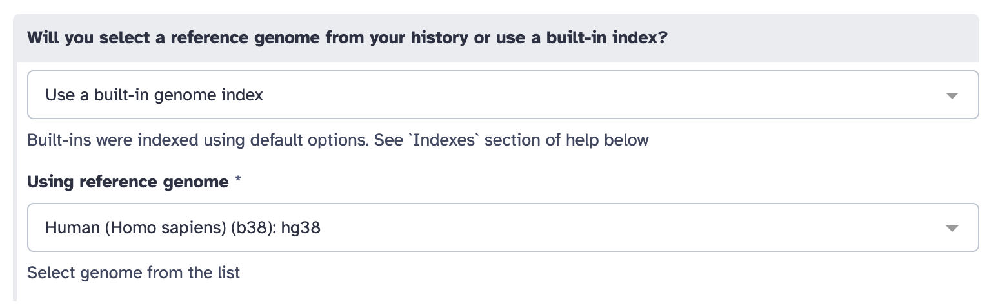
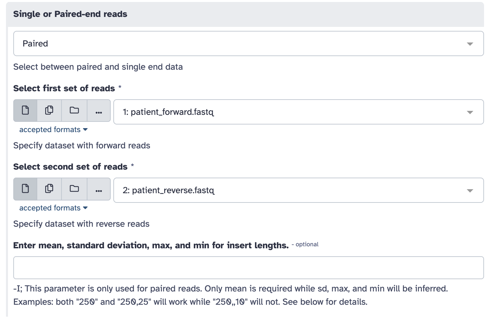
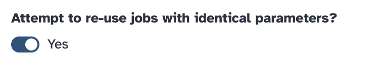

# Aktivita 2: Hľadanie mutácie v Galaxy

**Cieľ:** namapovať dáta pacienta na referenčný genóm a v genómovom prehliadači nájsť pozíciu mutácie.

**Postup v skratke:** účet v Galaxy → načítanie dát → mapovanie (Map with BWA-MEM) → zobrazenie v prehliadači → nájdenie mutácie


## Krok 1: Pridanie sa do Galaxy skupiny

1. Otvorte [usegalaxy.cz](https://usegalaxy.cz/).
2. Prihláste sa:
   - **Už ste niekedy používali usegalaxy.cz?** Prihláste sa rovnako ako doteraz.
   - **Ešte nie?** Kliknite na **LS LOGIN** a vytvorte si nový účet (ideálne pomocou školských údajov).

   > ℹ️ Klasická registrácia v tejto Galaxy nie je možná – nový účet si vytvoríte len cez **LS LOGIN**.
3. Otvorte odkaz [usegalaxy.cz/join-training/ai4talents](https://usegalaxy.cz/join-training/ai4talents) – tým sa pridáte do skupiny workshopu.

   > ⚠️ Link otvorte až keď ste **prihlásení** – do skupiny sa pridá práve prihlásený účet.
   

## Krok 2: Načítanie dát

Importujte históriu s dátami:

**Histories** → **Public histories** → **ai4talents_2** → **Import this history**

> priamy odkaz: [usegalaxy.cz/u/1b8ea9192727427c9be06de5b9a904cd/h/ai4talents_2](https://usegalaxy.cz/u/1b8ea9192727427c9be06de5b9a904cd/h/ai4talents_2)


## Krok 3: Mapovanie

1. V zozname nástrojov vyhľadajte `bwa mem` a vyberte **Map with BWA-MEM**.

   > ⚠️ Nepoužívajte **BWA-MEM2** ani **BWA-MEM2 indexer** – v tejto Galaxy majú k dispozícii len myší genóm, nie ľudský.
2. Nastavte parametre podľa obrázkov:

   **a) Referenčný genóm**

   

   **b) Dáta pacienta**

   

   **c) Ďalšie nastavenia**

   

3. Kliknite na **Run Tool**.

> ⚠️ **Ostatné parametre NEMEŇTE!**

Mapovanie chvíľu trvá. Keď sa výsledok v histórii zafarbí na zeleno, je hotové.


## Krok 4: Hľadanie mutácie

1. Pri výsledku mapovania v histórii kliknite na ikonu oka (**View**).
2. V genómovom prehliadači nájdite pozíciu mutácie.

<details>
<summary>💡 Nápoveda – kde hľadať?</summary>

Prejdite na chromozóm 11, na pozíciu:

```
chr11:5217179-5234011
```

</details>


---

[← späť na prehľad aktivít](README.md)
